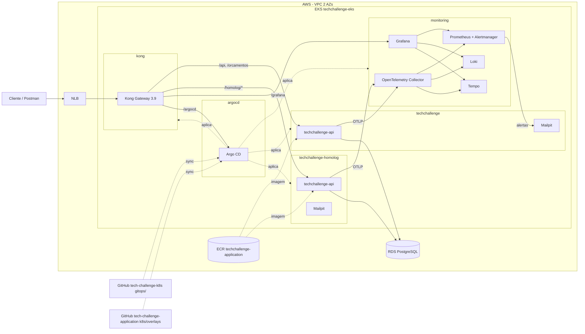

# tech-challenge-k8s

Infraestrutura Kubernetes do Tech Challenge (FIAP Pós-Tech 13SOAT, Fase 3).
O Terraform cria a rede, o cluster EKS, o ECR e instala o Argo CD; o Argo CD
entrega, por GitOps, o Kong, a stack de observabilidade e a API da oficina em
homologação e produção.

Repositórios da solução:

| Repositório | Responsabilidade |
| --- | --- |
| `tech-challenge-k8s` (este) | VPC, EKS, ECR, security groups, Argo CD e plataforma (`gitops/`) |
| `tech-challenge-terraform` | RDS PostgreSQL, Secrets Manager e Secret da API |
| Lambda de autenticação | Function serverless que emite o JWT |
| `tech-challenge-application` | API .NET, imagem no ECR e overlays Kustomize com a tag da imagem |

## Tecnologias

- Terraform >= 1.11 (backend S3 com `use_lockfile`), providers `aws`, `helm`, `kubernetes`, `random` e `tehcyx/kind`
- Amazon EKS 1.35 (recursos `aws_eks_*`), node group gerenciado t3.medium (2 a 3 nós), add-ons vpc-cni, kube-proxy, coredns, metrics-server e aws-ebs-csi-driver
- Argo CD (app-of-apps com sync waves)
- Kong Ingress Controller + Kong Gateway 3.9 OSS (DB-less) atrás de um NLB
- kube-prometheus-stack (Prometheus, Alertmanager, Grafana), Loki, Tempo e OpenTelemetry Collector
- Mailpit (SMTP de testes por ambiente)
- GitHub Actions

## Arquitetura



## Estrutura

```text
terraform/
  cluster/            # AWS: VPC, EKS, add-ons, ECR, SGs, StorageClass gp3, Argo CD
  local/              # kind: mesmo Argo CD e mesmo gitops/, sem AWS
  modules/platform/   # namespaces, Secret do Grafana, Argo CD e Application raiz
gitops/               # chart app-of-apps lido pelo Argo CD
  values.yaml         # componentes, versões dos charts e sync waves
  templates/          # Applications da plataforma e da API
  platform/           # values e manifestos de cada componente
docs/adr/             # decisões de arquitetura
```

Sync waves do app-of-apps:

| Wave | Applications |
| --- | --- |
| 0 | `kube-prometheus-stack` (CRDs do Prometheus Operator) |
| 1 | `loki`, `tempo`, `otel-collector`, `grafana-dashboards`, `alerts` |
| 2 | `kong` |
| 3 | `gateway` (rotas do Argo CD e do Grafana, plugin prometheus), `mailpit-homolog`, `mailpit-production` |
| 4 | `techchallenge-homolog`, `techchallenge-production`, `api-routes` (rotas da API e rate limiting) |

## Deploy no AWS Academy

### Configuração no GitHub (uma vez)

Em *Settings → Secrets and variables → Actions* da organização (vale para
todos os repositórios) ou deste repositório. Mesmos nomes da pipeline da Lambda:

| Tipo | Nome | Valor |
| --- | --- | --- |
| Secret | `AWS_ACCESS_KEY_ID` | sessão atual do Learner Lab |
| Secret | `AWS_SECRET_ACCESS_KEY` | sessão atual do Learner Lab |
| Secret | `AWS_SESSION_TOKEN` | sessão atual do Learner Lab |
| Variable | `AWS_DEPLOY_ENABLED` | `true` (sem ela só roda o CI, sem plan/apply) |
| Variable (opcional) | `AWS_REGION` | padrão `us-east-1` |
| Variable (opcional) | `TF_STATE_BUCKET` | padrão `techchallenge-tfstate-<account-id>` |
| Variable (opcional) | `AWS_DEPLOY_ROLE_ARN` | role OIDC fora do Academy; substitui as chaves |

O bucket do state é criado pela própria pipeline na primeira execução
(versionado e sem acesso público). Os environments `homolog` e `production`
são criados pelo GitHub no primeiro deploy; proteções (aprovação) são opcionais.

### A cada sessão do Learner Lab

As chaves do Academy expiram em 4 horas. Em *AWS Details → AWS CLI*, copie o
bloco para `~/.aws/credentials` e atualize os secrets (troque `--org` por
`--repo tech-challenge-SOAT16/<repo>` se eles forem do repositório):

```bash
for key in aws_access_key_id aws_secret_access_key aws_session_token; do aws configure get "$key" | gh secret set "$(echo "$key" | tr a-z A-Z)" --org tech-challenge-SOAT16 --visibility all; done
```

Se a sessão expirar, a pipeline falha no passo "Conferir sessão e bucket do
state" com a mensagem de credenciais expiradas.

### Pipeline (`.github/workflows/terraform.yml`)

| Evento | O que roda |
| --- | --- |
| PR para `develop` ou `main` | `terraform fmt`, `validate`, `tflint`, `terraform test`, render dos charts do `gitops/` e `terraform plan` |
| Push em `develop` (merge do PR) | apply no cluster (environment `homolog`) |
| Push em `main` (merge do PR) | apply no cluster (environment `production`) |
| Manual (*Run workflow*) | `apply` ou `destroy` (desligar o cluster para poupar crédito) |

O cluster é único (ADR 0002): `develop` e `main` aplicam o mesmo state, uma
execução por vez, e a plataforma do Argo CD acompanha `main`.

Toda mudança de Terraform e de plataforma neste repositório passa por PR. A
única exceção a PR na solução é o commit da tag de imagem feito por
`github-actions[bot]` nos overlays do repositório da aplicação
(ADR 0005); ela não vale para este repositório.

### Acesso ao cluster

Quem cria o cluster recebe acesso de administrador (access entry do EKS). No
Academy, a pipeline e o terminal usam a mesma role (`voclabs`) da conta, então
as mesmas credenciais da sessão funcionam nos dois:

```bash
aws eks update-kubeconfig --region us-east-1 --name techchallenge-eks
kubectl -n argocd get applications
```

### Manual (sem pipeline)

```bash
cd terraform/cluster
terraform init -backend-config="bucket=techchallenge-tfstate-$(aws sts get-caller-identity --query Account --output text)"
terraform apply
```

O bucket precisa existir (a pipeline cria na primeira execução). O apply leva
cerca de 20 minutos; depois o Argo CD sincroniza a plataforma sozinho.

## Acesso

```bash
# URL pública (NLB do Kong)
kubectl -n kong get svc kong-gateway-proxy -o jsonpath='{.status.loadBalancer.ingress[0].hostname}'

# Senha do admin do Argo CD (usuário admin)
kubectl -n argocd get secret argocd-initial-admin-secret -o jsonpath='{.data.password}' | base64 -d

# Senha do admin do Grafana (usuário admin)
terraform -chdir=terraform/cluster output -raw grafana_admin_password

# Caixa de entrada do Mailpit (produção; use -n techchallenge-homolog para homologação)
kubectl -n techchallenge port-forward svc/mailpit 8025
```

| Caminho no NLB | Destino |
| --- | --- |
| `/api`, `/orcamentos`, `/swagger`, `/openapi` | API de produção |
| `/homolog/...` | API de homologação (o Kong remove `/homolog`) |
| `/argocd` | Argo CD |
| `/grafana` | Grafana (pasta TechChallenge: 19924, 19925 e Ordens de Serviço) |

## Ambiente local (kind)

Sobe o mesmo Argo CD e o mesmo `gitops/` num cluster kind, sem AWS. As
Applications da API e das rotas dela ficam desligadas (`deploy_apps = false`):
no kind não há imagem no ECR, banco nem Secret da API.

```bash
cd terraform/local
terraform init
terraform apply -var gitops_revision=<branch-publicada>
export KUBECONFIG=$PWD/kubeconfig
kubectl -n argocd get applications
```

- Argo CD: <http://localhost:9080/argocd>
- Grafana: <http://localhost:9080/grafana> (`terraform output -raw grafana_admin_password`)

O kubeconfig fica em `terraform/local/kubeconfig`; o contexto atual de
`~/.kube/config` não é alterado. Para remover: `terraform destroy`.

## Integração com os outros repositórios

Outputs de `terraform/cluster` (state `tech-challenge-k8s/cluster.tfstate`):
`vpc_id`, `private_subnet_ids`, `public_subnet_ids`,
`database_security_group_id` (anexar ao RDS), `lambda_security_group_id`
(anexar à Lambda dentro da VPC), `cluster_security_group_id`, `cluster_name`,
`ecr_repository_url`.

Contrato com a aplicação:

- Secret `techchallenge-api-secrets` em `techchallenge` e
  `techchallenge-homolog`, criado pelo `tech-challenge-terraform`.
- SMTP: `Smtp__Host=mailpit`, `Smtp__Port=1025` em cada namespace.
- OpenTelemetry: `OTEL_EXPORTER_OTLP_ENDPOINT=http://otel-collector.monitoring.svc.cluster.local:4317`.
- Overlays `k8s/overlays/aws-eks-homolog` e `k8s/overlays/aws-eks`, ambos na
  branch `main`, com a tag da imagem de cada ambiente.

## Demo

Roteiro da demonstração (credenciais no GitHub, subida do ambiente, endereços e
vídeo) em
[tech-challenge-application/docs/demo/fase-3](https://github.com/tech-challenge-SOAT16/tech-challenge-application/blob/main/docs/demo/fase-3/README.md).

## Decisões

- [ADR 0001 — Argo CD e GitOps](docs/adr/0001-argocd-gitops.md)
- [ADR 0002 — Um cluster EKS com namespaces por ambiente](docs/adr/0002-eks-cluster-unico-namespaces.md)
- [ADR 0003 — Kong como API Gateway](docs/adr/0003-kong-api-gateway.md)
- [ADR 0004 — Observabilidade com OpenTelemetry e stack Grafana](docs/adr/0004-observabilidade-grafana-opentelemetry.md)
- [ADR 0005 — Tag da imagem nos overlays do repositório da aplicação](docs/adr/0005-gitops-tags-no-repo-da-aplicacao.md)
